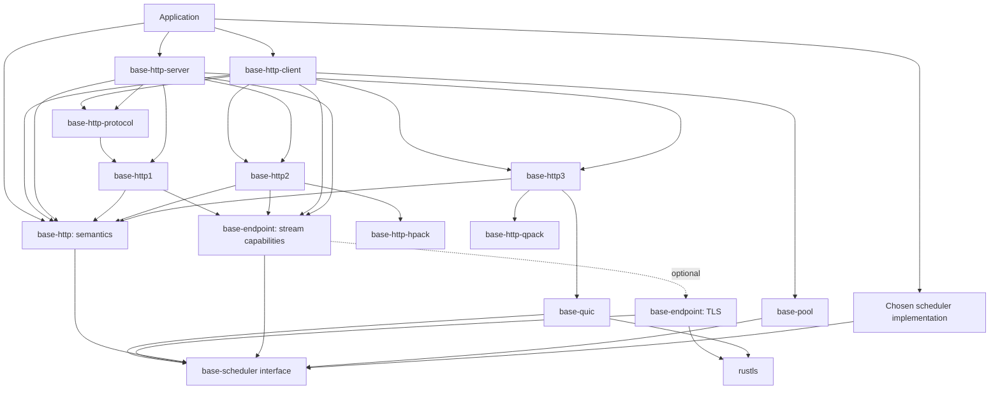

# Base HTTP: top-down design proposal

Status: proposed for discussion, 2026-10-25. The [implementation notes](implementation.md) identify the initial body code and its scheduler integration checks. The remaining package names and interfaces below are recommendations. The [source review](source-review.md) distinguishes existing behavior from proposed changes.

Baseline updated 2026-10-26: the package/import rename and migration to registry `base-scheduler` / `base-scheduler-direct` at `0.1.0` are implemented. The semantic core includes fields, messages and scalar types, static/bounded pull bodies and interim-response hooks, plus native HTTP/1 client/server framing, the initial application server and a [duplex proxy experiment](duplex.md). Transport design targets the released [scheduler I/O capabilities](../../base-scheduler/context/io.md); the [implementation notes](implementation.md) delimit completed behavior and remaining work.

The [component evaluation](components.md), updated 2026-10-26, compares native ports, focused forks and dependencies for parsing, HPACK, QPACK, TLS and QUIC. The subsequent design direction is native `base-quic` and `base-http3`, focused compression crates, and rustls TLS, currently implemented in `base-endpoint::tls`. Existing QUIC implementations remain references, interoperability peers and possible sources for focused forks. The [build roadmap](roadmap.md) defines the implementation order and stage acceptance evidence.

Architecture updated 2026-10-28: [clients, connections and protocol negotiation](client-connection.md) defines the durable client and established connection roles, selection on both sides, and one HTTP multiplex pool contract with capacity one for HTTP/1. The initial scoped HTTP/1 client now implements that admission contract and independent upload/download. HTTP/1 TLS/ALPN now uses a shared protocol-factory layer; additional protocol engines remain follow-up work. See [transport layering](transport.md).

## 1. Proposed direction

Make **`base-http` the semantic root**, porting `protocol-http`'s established message, header and body model to Rust. Base owns these contracts, including readiness, informational responses, replay and completion. Put HTTP/1 and HTTP/2 connections in companion crates, and put pooled clients and serving infrastructure above them. Use composition in place of Ruby's request/response subclasses. Rust `http`/`http-body` interoperability can be an optional adapter; it is not a prerequisite for the semantic port.

Implement native HTTP/1 and HTTP/2 protocol engines over `base-scheduler` owned-buffer operations. Keep control of framing, connection progress, buffer ownership and submission batching in Base. Focused components can be native ports, extractions, forks or dependencies: `base-http-hpack` and `base-http-qpack` own the compression interfaces, while `base-endpoint::tls` provides optional rustls integration. Hyper and the `h2` engine are excluded from the implementation dependency path; an `AsyncRead`/`AsyncWrite` compatibility adapter is not the transport foundation. Extracting focused algorithm code from those projects remains an option. Implement QUIC in `base-quic` and build the native `base-http3` HTTP mapping above it with the same ownership and explicit execution model.

The performance goal is to outperform Hyper/Tokio on defined workloads using the scheduler's Linux io_uring backend. Design for buffer reuse and batching, and establish the result through comparable end-to-end benchmarks. The scheduler interface remains portable; backend-specific optimizations must be exercised by real protocol consumers.

Use **`base-pool::MultiplexPool` for HTTP client connections**, with admission supplied by each established connection: capacity one for HTTP/1 and protocol-specific stream limits/credit for HTTP/2 and HTTP/3. The endpoint need not know the selected protocol before connecting. The initial [generic implementation](../../base-pool/readme.md) also provides a distinct `SingleplexPool` for exclusive resource leases; The scoped HTTP/1 client now uses its capacity-one multiplex admission. The generic pool does not perform protocol negotiation. See the [client/connection taxonomy and negotiation design](client-connection.md).

Start with a complete HTTP/1 client/server path and capacity-one admission in the multiplex pool. Extend that same HTTP pool contract with an HTTP/2 ownership prototype before stabilizing the pool API. HTTP/3 fits the semantic and multiplex boundaries; its `base-quic` transport is a separate substantial implementation work package.

The intended application model is:

1. Construct ordinary `Request<B>` and `Response<B>` values.
2. Process the same values in middleware, applications, tests, proxies, and protocol implementations.
3. Select a transport and protocol through explicit endpoint configuration or negotiation.
4. Construct reader/writer capabilities from the selected scheduler explicitly, then pass cancellation to their operations.
5. Keep an exchange's resources charged until its protocol and ownership obligations finish.

This preserves the architecture of `protocol-http` + `protocol-http1/2` + `async-http`, rather than translating their class hierarchy literally.

## 2. Scope and boundaries

| Scope | Proposed work |
| --- | --- |
| Shared semantics | Base-owned requests/responses, request-target components, method/status/header types, static and streaming bodies, readiness, informational responses, protocol/tunnel intent, peer metadata. |
| HTTP/1 | Incremental parsing and encoding, HTTP/1.1 persistence, HTTP/1.0 compatibility, body framing, client/server exchanges, bidirectional bodies for tunnels/upgrades. |
| HTTP/2 | Frame and stream state, HPACK, settings, flow control, shared connection progress, admission, resets, GOAWAY and graceful draining. |
| Pooling | Exclusive leases, multiplex reservations, bounded construction, cancellation, retirement, explicit maintenance and shutdown. |
| Client | Endpoint selection, connection establishment, negotiation, pooling, request execution, bounded retry policy. |
| Server | Accepted-transport serving, optional listeners, handler dispatch, informational/final responses, admission and shutdown. |
| Transport support | Owned-buffer stream operations over scheduler sockets, buffering, partial transfers, TLS adaptation. |
| Later convenience | Multi-origin client cache, redirects, compression, CONNECT proxy connectors, tracing/metrics integration, optional Rust ecosystem adapters. |
| Separate follow-up | HTTP/3 and QUIC, WebSocket/WebTransport implementations, caches, cookies, routing frameworks, HTTP/1 pipelining. |

An ordinary streaming HTTP request/response path is the first usable milestone. WebSocket framing and proxy convenience APIs can follow, but the initial message and ownership model must leave room for tunnels, early responses, trailers, and bidirectional use.

No new executor, reactor, system resolver, or runtime-selection feature belongs in this project. Concrete scheduler adapters are development dependencies. `base-scheduler` itself is an allowed production dependency: it is an interface and runtime-independent support, not a concrete runtime.

## 3. Crate structure

### Recommendation: semantic root, companion implementations

| Package | Responsibility | Main production dependencies |
| --- | --- | --- |
| `base-http` | Native semantic messages, headers, bodies, errors and lifecycle helpers, ported from `protocol-http`. | Runtime-independent support; `base-scheduler` cancellation/support where required. No mandatory `http`/`http-body` dependency. |
| `base-http1` | HTTP/1 codec, exchange state, client/server connection drivers. | `base-http`, transport support, scheduler interface. |
| `base-http2` | Native HTTP/2 engine and connection drivers. | `base-http`, `base-http-hpack`, transport support, scheduler interface. |
| `base-http-hpack` | Encoder/decoder, dynamic table and Huffman/integer primitives. | Byte-oriented support as needed; no scheduler or semantic-message dependency. |
| `base-http-qpack` | HTTP/3 field compression and instruction state, staged from static/literal support. | Shared compression primitives as justified; no scheduler or semantic-message dependency. |
| `base-http-client` | Endpoint clients, negotiated protocol dispatch, pool integration, retries. | `base-http`, selected protocol crates, `base-pool`, transport support. |
| `base-http-server` | Connection serving, listener orchestration, handler context and shutdown. | `base-http`, selected protocol crates, transport support. |
| `base-pool` | General resource admission, leases, reservations and lifecycle. | Runtime-independent synchronization; scheduler interface where cancellation/clocks are needed. No HTTP dependency. |
| `base-http-protocol` | Shared HTTP engine selection, ALPN policy and client/server codec factories. | Enabled protocol codecs and transport-neutral stream capabilities; no encryption implementation. |
| `base-endpoint` | Connection/binding establishment, plaintext stream capabilities and optional TLS providers with explicit progress ownership. | Scheduler interface; optional rustls. No HTTP dependency. |
| `base-quic` (later) | Native QUIC transport state and scheduler-driven UDP packet/timer progress. | Scheduler interface; rustls QUIC handshake/key support and selected algorithm code. No HTTP dependency. |
| `base-http3` (later) | Native HTTP/3 mapping, connection/control streams and client/server protocol drivers over QUIC. | `base-http`, `base-http-qpack`, `base-quic`. |

The initial HTTP packages are standalone siblings with local path dependencies. Avoid introducing a parent workspace over unrelated Base projects. `base-pool` is a standalone sibling, now released at `0.3.0` with an experimental API, generic conformance tests and a TCP reuse/retirement test. Exercise its contracts through actual HTTP connection consumers before stabilizing the API. It is not a prerequisite for the first server prototype.

Start bodies as `base_http::body` inside the semantic root, following `protocol-http`. A separate `base-http-body` package needs an independent consumer or dependency benefit. The initial implementation keeps body interfaces and adapters in a module while their scheduler contracts are exercised.

The first endpoint adaptation now exists. The HTTP/HTTPS integration uses its small plaintext stream interfaces and supervised rustls implementation directly, with no separate `base-stream`, `base-http-io` or `base-tls` package. A later extraction needs a concrete consumer or dependency benefit. The shared HTTP protocol layer stays above transport security and below application client/server orchestration; see [transport layering](transport.md).

Dependency arrows point from a consumer to its dependency. The graph shows the full planned stack; protocol dependencies in the client/server packages are feature-selectable:



Application middleware depends on `base-http`; it need not pull in a client, server, TLS implementation, or wire codec. An optional adapter package can depend on both Base and ecosystem interfaces without adding those dependencies to the native semantic layer.

### Client/server composition and protocol features

`base-http-client` directly depends on `base-http` for semantic messages/bodies and `base-pool` for connection admission/reuse. Its `http1`, `http2` and `http3` Cargo features enable the corresponding optional `base-http1`, `base-http2` and `base-http3` dependencies. `base-http-server` directly depends on `base-http` and exposes the same protocol feature choices for its connection-serving implementations. Server handler admission is separate from outbound connection pooling; the server does not require `base-pool` merely because the client uses it.

An HTTP/1-only build does not pull in HTTP/2, HPACK, HTTP/3, QPACK or QUIC. Enabling `http3` brings in `base-http3`, and through it `base-http-qpack` and `base-quic`. Compile-time features select available implementations; endpoint/server configuration selects among the implementations compiled into the application. Default protocol features remain to be settled before publishing manifests.

The client/server packages supply the application-facing `Client` and `Server` implementations. They compose endpoint/listener configuration, transport establishment, protocol selection and supervised drivers with semantic requests/responses. The protocol crates separately expose low-level client/server connection APIs so a caller can drive a known protocol directly. `base-http` supplies the shared semantic layer; it has no dependency on protocol implementations or concrete client/server orchestration.

A `Client` is the durable capability for interacting with a remote server. A `Connection` is one established transport with its selected HTTP protocol session. Protocol selection exists on both the client and server paths; TLS ALPN, configured plain protocols and QUIC establishment have distinct transport requirements. The [taxonomy](client-connection.md) defines these boundaries and their lifetimes.

Proposed application imports:

```rust,ignore
use base_http::{Request, Response};
use base_http_client::Client;
use base_http_server::Server;
```

### Why not put `Client` and `Server` in the root too?

If `base-http1` consumes root message types and the root consumes `base-http1` to expose a concrete client, that creates a Cargo dependency cycle. Features and re-exports do not remove the cycle.

There are two coherent alternatives:

| Arrangement | Consequence |
| --- | --- |
| Root `base-http` is semantics; clients/servers are companions. **Recommended.** | Follows the interface-root pattern of `base-scheduler`; the shortest crate name belongs to the types everyone shares. |
| `base-http` is an application facade; semantics live in `base-http-types` or `base-http-protocol`. | Gives users `base_http::Client`, but every codec and middleware depends on the semantic sub-crate instead. |

A single crate containing semantics, codecs and clients behind features also works without a cycle. It gives up separate package/dependency boundaries. Prefer it only if a single application facade is more important than the semantic root. Do not create two competing sets of request/response types.

## 4. Shared messages

### Port the native semantic model

Port `protocol-http` into Base-owned `Request<B>` and `Response<B>` types, adapting `Protocol::HTTP::Headers` into raw storage and explicit interpretation. The implementation uses `message.fields`, backed by `Fields::pairs()`. Preserve Socketry's protocol-independent fields and behavior; adapt ownership, errors and composition to Rust. Applications, middleware and wire protocols use the same types. Constructing or inspecting message metadata performs no I/O.

| Value | Proposed representation/meaning |
| --- | --- |
| Method | A validated token with constants and predicates for known methods; unknown valid methods remain representable. |
| Scheme, authority, path/query | Separate request components, following Socketry's model. Preserve request-target forms and resolve relative requests before transmission where required. Store schemes and authorities in lowercase, the canonical form for these case-insensitive components ([RFC 3986, sections 3.1](https://www.rfc-editor.org/rfc/rfc3986#section-3.1) and [6.2.2.1](https://www.rfc-editor.org/rfc/rfc3986#section-6.2.2.1)). HTTP authorities are a host and optional port, without userinfo ([RFC 9110, section 4.2.4](https://www.rfc-editor.org/rfc/rfc9110#section-4.2.4)). Preserve paths and queries, which are case-sensitive. HTTP/2 and HTTP/3 schemes are not restricted to `http` and `https`, so other schemes remain representable. |
| Protocol intent | Typed Base metadata, separate from HTTP version, covering upgrades and extended CONNECT. |
| Version | Optional before negotiation; records the wire version on received messages. Outbound protocol policy belongs in execution options. |
| Status | Base status value and Socketry-style classification predicates; informational/final response sequencing is explicit. |
| Message metadata | `RequestMetadata` / `ResponseMetadata`, raw ordered `Fields` (token names and opaque byte values; each protocol driver enforces which value bytes it can carry, so negotiated binary values remain representable), and typed representation/protocol controls. Optional `HttpHeaders` interpretation owns its index and trailer provenance. |
| Body | Generic `B` implementing native Base body contracts; `EmptyBody` provides a cheap empty representation. |
| Peer/security information | Typed descriptive metadata or the operation context. |
| Interim responses | Explicit exchange callbacks/responder capabilities carrying Socketry's behavior outside the head. |
| Bidirectional bodies | Paired input/output and streamable body execution for ordinary streaming, upgrades and CONNECT. |

Protocol preparation validates combinations before sending: ordinary resource requests, `OPTIONS *`, traditional CONNECT, and extended CONNECT have different required fields. HTTP/1 rendering and HTTP/2 pseudo-header validation remain codec concerns. Do not apply URL decoding, path normalization, or method rewriting as an incidental parse step.

The initial implementation provides constructors, public `RequestMetadata`/`ResponseMetadata`, metadata/body decomposition and consuming body mapping without requiring a wire codec. `Deref` exposes metadata members directly; arbitrary body owners need no body trait or cloning merely to be carried or mapped. Keep non-cloneable leases, execution capabilities, transport ownership and final-response capabilities in explicit body/exchange owners. Base metadata types must not require a Hyper dependency merely to represent protocol intent.

### Raw fields and explicit header interpretation

`Fields` owns an ordered sequence of `Field` pairs with token names and opaque byte values. Preserve supplied name spelling, duplicate pairs, spacing and opaque value bytes. Raw lookup/mutation is case-insensitive by name, without combining or parsing values. Storage has no trailer marker, policy or semantic index.

`HttpHeaders::new(fields)` explicitly interprets an owned initial section. It caches lookup lazily and applies `headers::Policy`: comma lists, semicolon-joined cookies, separately emitted cookies/challenges, singleton checks and trailer eligibility. Custom overrides let application interpreters change these choices; a different protocol can also interpret raw `Fields` independently. Lookup takes `&mut self`, with no interior mutability or shared message ownership.

`HttpHeaders::append_trailers(fields)` accepts a separate received trailing section and records its provenance, including an empty section. Interpreted values can reflect both sections while `headers()` and `trailers()` remain distinct. Recover both with `into_parts()`; arbitrary trailer fields must not silently become initial fields. There is no `Fields::mark_trailers()` operation. Bodies deliver `BodyFrame::Headers`; collection and forwarding are explicit caller choices.

```rust,ignore
struct Fields {
    pairs: SmallVec<[Field; 1]>,
}
struct HttpHeaders {
    fields: Fields,
    tail: Option<usize>,
    indexed: Option<Box<Index>>,
    policy: Policy,
}
```

The codecs validate control values before exposing application fields. HTTP/1 extracts Content-Length into `metadata.content_length`, Host into request authority, transfer coding into framing, and Connection/Upgrade into exchange/negotiation state. It removes those wire fields, standard connection controls and all Connection-nominated fields regardless of order. Their names remain private exchange state so trailing fields are filtered too. The single-token protocol intent remains available as typed metadata; raw multi-offer upgrade negotiation remains private to the exchange. HEAD and 304 retain a declared Content-Length despite having no readable data. `metadata.persistent` expresses an outgoing reuse preference; received hop decisions are not automatically forwarded to a new connection.

Callers may still supply raw outgoing control fields; preparation validates duplicates, conflicts and typed/raw consistency. Generated controls stay in the wire output without mutating application metadata. Wire framing and mandatory trailer restrictions never depend on application interpreter overrides.

Implemented scope includes raw pairs, the explicit interpreter, lazy combination/indexing, custom policy and trailer provenance. Field-specific date/range/authentication/negotiation/structured-value parsers remain follow-up work. See [implementation evidence](implementation.md).

### Optional ecosystem adapters

Rust ecosystem compatibility means accepting the types and traits expected by another library. Hyper uses [`http::Request`/`Response`](https://docs.rs/hyper/latest/hyper/); many body utilities use [`http_body::Body`](https://docs.rs/http-body/latest/http_body/trait.Body.html). [`tower-http`](https://docs.rs/tower-http/latest/tower_http/) supplies HTTP middleware, while [`tower::Service`](https://docs.rs/tower-service/latest/tower_service/trait.Service.html) itself is generic over request types.

An optional adapter can translate ordinary heads and wrap streaming bodies. It must document which native semantics cross the boundary: a `HeaderMap` has no guaranteed global field order and its `HeaderName` representation normalizes casing; readiness, replay, close/discard and interim-response operations require contracts beyond the standard message/body types. Conversions must not silently claim full fidelity. See [HeaderMap](https://docs.rs/http/latest/http/header/struct.HeaderMap.html#iteration-order) and [HeaderName](https://docs.rs/http/latest/http/header/struct.HeaderName.html).

Shared types do not establish runtime compatibility. Middleware using Tokio timers or spawning still needs execution integration; Axum explicitly targets Tokio and Hyper. Evaluate concrete integrations individually rather than making ecosystem support an acceptance gate for the native port. [Axum compatibility](https://docs.rs/axum/latest/axum/#compatibility).

## 5. Streaming body contract

The native interface has one pull-body trait returning owned frames. Initial fields live in message metadata; received trailers move through body frames and can be forwarded or explicitly accumulated in a header interpreter. Informational responses remain explicit exchange events.

```rust,ignore
pub enum BodyFrame<D> {
    Data { data: D, end: bool },
    Headers { fields: Fields, end: bool },
    End,
}

pub trait ReadableBody: Send {
    type Data: AsRef<[u8]> + Send;
    type Error: std::error::Error + Send + Sync + 'static;

    fn is_ready(&self) -> bool { false }
    fn is_empty(&self) -> bool { false }
    fn length(&self) -> Option<u64> { None }
    fn may_have_trailers(&self) -> bool { true }
    fn is_rewindable(&self) -> bool { false }
    fn rewind(&mut self) -> bool { false }
    fn close(&mut self, error: Option<Self::Error>);
    fn read(&mut self, cancellation: &Cancellation)
        -> impl Future<Output = Result<BodyFrame<Self::Data>, Self::Error>> + Send;
}
```

Readiness, exhaustion, length and replay are independent. `length` describes the whole representation, including for a `HeadBody` that emits no bytes. `BodyFrame::is_end()` detects completion on data, fields, or a separate `End`. Empty nonfinal data is ordinary data; a terminal payload can be delivered without another read. After completion, reads return `End`. Memory bodies need no scheduler; I/O bodies can retain explicitly constructed bound readers. Every read future is `Send`.

`Request::read` and `Response::read` return frames directly and leave metadata untouched. A `Headers` frame owns the complete decoded trailer section; the caller can forward it or move its fields into an explicit interpreter with `HttpHeaders::append_trailers`. No `finish(&mut Fields)` hook or shared mutable metadata is required. Body headers occur at most once and follow all data. When `end` is false, only completion or error may follow those fields. `ReadableBody::may_have_trailers()` conservatively defaults to true. HTTP/1.1 selects chunked framing before reading when trailers are possible, while still validating a known representation length. Static bodies return false. A false result promises no trailing headers. HTTP/1.0 cannot represent trailers and rejects actual header frames.

Queue delivery moves an owned data buffer or stable buffer handle, not a borrow of the connection reader's scratch storage. `D` is the body's existing `Data` associated type, requires `Send` but not `Clone`, `Sync`, or `Default`, and can retain transport-specific storage/credit leases. `BodyFrame::map_data` preserves fields and completion when adapting data owners. A proxy can move frames directly into its outgoing body. The connection driver retains protocol state and per-stream producing handles; the incoming body owns its receiving handle. Dropping a pending queue read preserves undelivered frames. Body abandonment notifies the driver, which owns protocol cleanup and resource retirement.

HTTP/2 maps final DATA or trailing HEADERS to a terminal frame after completing any field-block decoding. HTTP/3 obtains completion from QUIC separately and may deliver nonfinal data or fields before learning of the end. An implementation must allow a later `End` without holding back application data. QUIC already demultiplexes receive streams, so HTTP/3 can parse on a stream's read path without adding another HTTP-level queue. Application completion and safe reuse/release of submitted I/O buffers remain distinct.

The protocol driver pulls chunks, applies framing and backpressure, flushes before awaiting further production, and supervises cancellation and retirement. Pull-driven production runs within that future. `IncomingBody` can be returned directly as a response body for streaming echo; a custom readable body can consume input while generating output. Imperative application production can run concurrently through a bounded body pair. Client request transmission and server response transmission use the same outgoing-body contract; incoming request and response bodies use the same readable-body contract. This replaces the earlier experiment with separate direct-stream callbacks and pull adapters.

`WritableBody` is the producer trait: `write_frame`, convenience nonfinal data `write`, `flush`, `close_write` and `abort`. A successful terminal frame closes output atomically; writes after completion fail. Queues enforce data-before-headers ordering. `BodyReader<D>` and `BodyWriter<D>` are its bounded queue endpoints, returned by `BodyReader::bounded(max_bytes, max_chunks)` or `with_length`. Imperative application producers run explicitly supervised concurrent work. Every frame counts toward the item limit; data bytes and header name/value bytes count toward the byte limit. Oversized frames fail immediately. Normal closure preserves queued frames and can mark the last payload as final; failure discards them. Queue capacity and protocol receive credit have separate lifetimes. Dropping either endpoint wakes its peer. Application chunks need not implement unsafe completion-I/O buffer traits.

Implemented concrete bodies are `EmptyBody`, `BufferedBody`, `HeadBody` and `BodyReader`. `BufferedBody` supports replay. Body mapping preserves concrete types and owners; there is no compulsory boxing or dynamic dispatch. A boxed adapter can follow when heterogeneous application return types justify it. Bounded collection/discard helpers and owning file bodies also remain follow-up work.

For HTTP/1 upgrades and all successful CONNECT responses, the final handshake is flushed before body reads switch to raw data. Buffered incoming bytes survive the switch. The server retains the socket, lifecycle cancellation and lane retirement; future HTTP admission stops. HTTP/2 and HTTP/3 will retain the connection and apply duplex semantics to one stream. See the [Ruby source review](source-review.md#bidirectional-bodies-upgrades-and-interim-responses).

An optional `http-body` adapter remains future ecosystem integration. It does not determine the native body model.

## 6. Execution and transport interfaces

### Scheduler contract

Follow the released [scheduler design](../../base-scheduler/context/design.md) and [I/O guide](../../base-scheduler/context/io.md): explicitly construct resource-bound readers and writers from the chosen scheduler, retain them in the protocol/transport owner, and pass cancellation per operation. Each handle keeps its creating scheduler; worker migration and registration remain backend concerns. There is no implicit current scheduler or replacement scheduler argument on a handle operation.

Use the smallest required capabilities. Parsing needs none. Socket transport needs read/write, dialing additionally needs resolution/open/connect, a listener needs accept, and timeout policy needs `Clock`. Spawn is optional orchestration, not a prerequisite for using a codec or driving one connection.

Preserve `Send` operation futures and the scheduler's resource compatibility rules. Do not require `Clone`, `'static`, or a universal scheduler aggregate for a borrowed operation. A spawned owner has additional explicit `Send + 'static` bounds. Keep the chosen scheduler and its drivers alive until bound handles have finished cleanup. The historical file-body test's scheduler-switching behavior is not a released-handle requirement.

### Stream seam

HTTP/1 and HTTP/2 consume byte-stream capabilities. Start with the released `SocketStreamReader` and `SocketStreamWriter`: owned chunk reads, borrowed parser storage, borrowed writes and owned ordered submissions with explicit flushing. Construct independent handles for concurrent input/output. Memory transports support deterministic tests; no new scheduler-parameterized stream trait is a prerequisite.

Protocol-specific buffering and serialization retain exclusive owners. Flush successful output before awaiting each handle's uncancellable `close()`, then drop the handles before exclusively closing the socket. Handle closure establishes retirement; it does not imply transport shutdown or peer acknowledgment. Exact transport error mapping and TLS-specific closure reporting need prototype validation.

TLS wraps this seam with explicit configuration and peer metadata. It must preserve pending ciphertext and partial writes, coordinate shared TLS state without holding locks across I/O waits, and distinguish orderly TLS shutdown from truncation.

The first integration uses the buffered rustls API in `base-endpoint::tls` with supervised duplex progress and persistent scheduler handles. Wider fragmentation/fault injection, an unbuffered storage experiment and performance measurements remain follow-up work. The [component evaluation](components.md) distinguishes this from QUIC's separate TLS interface.

Build protocol-aware buffering above single-transfer operations: preserve unread ranges, finish partial writes in order, and treat zero progress appropriately. Keep framing and parser state independent of I/O so fragmented/coalesced input can be tested without a runtime.

Use the released ownership paths: borrowed reads into reused parser storage or uniquely mutable `ReceiveBuffer` chunks that can freeze into retained immutable views. Exercise mutation and retention through that portable contract. Multishot/registered-buffer selection stays behind the reader/writer API. The earlier immutable multishot-lease finding belongs to the historical research snapshot and is not a demonstrated gap in the released receive contract.

### Driver lifetime and application handles

Use an explicitly owned connection driver for full-duplex progress. Construction borrows the explicit scheduler; its running future takes connection-lifecycle cancellation. Handles contain bounded queues, exchange state and notifications; they contain no scheduler instance.

The recommended high-level client form is conceptually:

```rust,ignore
let (client, driver) = Client::new(&scheduler, endpoint, options)?;

let application = async {
    let request = Request::get("/");
    let mut response = client.call(request, &request_cancel).await?;

    loop {
        let frame = response.read(&request_cancel).await?;
        let end = frame.is_end();
        consume_frame(frame)?;
        if end { break; }
    }

    client.begin_close();
    Ok(())
};

// Schematic structured concurrency: both futures keep making progress.
run_together(driver.run(&lifecycle_cancel), application).await?;
```

`client.call` here submits work and returns when final response headers are available, with a streaming response body. The explicitly running driver performs dialing and protocol I/O, and continues pulling the request body after `call` returns when necessary. Application consumption of the response does not drive request transmission. Do not add an unused scheduler argument to a queue-only operation. I/O-backed bodies retain their explicitly bound capabilities. An application producing a queue body writes through its paired `BodyWriter` in separately supervised work, which may use a different compatible context.

The registered exchange can retain a clone of its explicit cancellation signal through terminal completion; this is distinct from retaining a scheduler. Cancelling or dropping `call` before response ownership transfers withdraws queued work or requests exchange abandonment. After transfer, the response body retains the application-facing completion/abandonment obligation, including bidirectional use; the exchange/driver retains resource cleanup. Cancelling an individual queue-body read can leave the body resumable, while cancellation of the exchange's lifetime signal still terminates the exchange. Dropping a signal alone does not cancel it.

A direct low-level connection/body API may also take scheduler arguments per operation. It must make its remaining progress obligations explicit. Returning a response while an upload is still active cannot leave that upload dependent on the caller happening to read the response body.

A pooled client driver supervises connection drivers and request-transmission futures; a server operation supervises connection, handler and response-transmission futures. Imperative application producer work has its own explicit owner. The scoped HTTP/1 prototype polls owned child futures within that running operation; this interleaves connections but does not schedule them independently across workers. The scalable client must keep client-wide supervision separate from independently schedulable connection drivers, particularly for HTTP/2 framing/demultiplexing. `Spawn` orchestration takes explicitly owned scheduler/transport state satisfying `Send + 'static` and retains every owning task handle in a session/supervisor. A borrowed scope requires an explicit scoped executor contract instead. Dropping a scheduler task handle destroys work rather than detaching it, so dropping handles immediately is incorrect.

Define separately:

- `begin_close`: synchronously stop admission and wake waiters.
- Graceful driver completion: finish accepted work, retire resources, and await owned children.
- Forced shutdown: abort remaining exchanges after the chosen grace policy, retire pending I/O safely, then close.
- Drop: synchronous abandonment and safe resource release; it cannot promise an asynchronous handshake or drain completed.

The session/driver API needs a feasibility prototype before stabilization. In particular, prove heterogeneous and borrowed bodies across `call` return, `Send` bounds, body error propagation and spawned ownership without an implicit scheduler or a self-owning task cycle. Preserve the symmetric application interface described in the [duplex design](duplex.md#symmetric-application-interface): handlers return responses, and client drivers retain ongoing uploads.

## 7. Protocol behavior and implementation

### HTTP/1

Use a codec state machine plus an exchange owner. Expose semantic heads and bodies, not a second HTTP/1-specific application message hierarchy. Borrow Socketry's states and regression scenarios, while making resource ownership explicit in Rust.

Start with one active exchange per connection. HTTP/1 pipelining is intentionally outside this pool contract. Writes and reads still progress concurrently within that exchange, so an early response does not deadlock behind a blocked request producer.

If the peer sends a final response while refusing further upload bytes, stop the producer according to exchange policy and preserve response readability. A request still being produced may finish after the response and permit reuse; an abandoned or failed upload disables reuse. Expose the response without waiting for the upload, and keep both directions independently polled until completed or explicitly cancelled. See the [duplex experiment](duplex.md).

Implement start lines, fields, body framing, chunked trailers, persistence and bidirectional upgrade/CONNECT bodies incrementally. Cover HTTP/1.0 close-delimited responses and HTTP/1.1 framing. Distinguish clean idle EOF from truncated headers/body. Special cases include HEAD, bodyless statuses, informational responses, and successful CONNECT responses. The framing reference is [RFC 9112](https://www.rfc-editor.org/rfc/rfc9112.html#section-6.3).

Choose a documented strict parsing policy: reject conflicting lengths and transfer framing, invalid field syntax, unsupported transfer coding chains, and invalid authority/Host combinations according to the request-target form. Reject oversized lines, total headers, field counts and trailers before unbounded growth. Preserve unread buffered bytes when transitioning to upgraded body I/O. Flush the accepted response head before a body read that might wait for peer data, and define rejection and early-write behavior explicitly.

The connection admits another pooled use only after both local output and remote input are complete and framing is synchronized. An abandoned or partially written exchange is conservatively non-reusable unless an explicit bounded drain completes. No arbitrary asynchronous I/O belongs in active-use drop; its owner performs and acknowledges cleanup.

### HTTP/2

Separate frame parsing/encoding, connection state, stream state, compression, and application progress. One owner orders outbound frames and header blocks; independent request handlers must never interleave pieces of a partially written frame or HEADERS/CONTINUATION block.

A connection receive loop runs independently of application body reads and stream output. It routes incoming frames to stream state, delivers final heads to waiting calls or handlers, and feeds per-stream input queues. Incoming bodies expose those queues through `ReadableBody`. Stream output work pulls outgoing bodies and uses ordered connection writes under stream/connection flow control. The same progress architecture serves client and server roles; application-owned `BodyWriter` producers remain separate from protocol output work. See the [symmetric duplex design](duplex.md#protocol-specific-progress-owners).

The implementation work includes prefaces/settings, frame validation, stream identifiers, HPACK, data and trailer delivery, informational responses, stream/connection flow control, resets, pings, GOAWAY, and error scope. Disable server push by default. Extended CONNECT and priority extensions can be staged after the ordinary exchange path; unsupported features still need defined protocol handling.

Admission, data-flow credit and application memory are separate limits. Dynamic peer settings affect admission; stream/connection windows affect data transfer. GOAWAY immediately removes a connection from new-work selection while accepted streams drain. A request outside the peer's accepted stream range can be classified as unprocessed. [RFC 9113](https://www.rfc-editor.org/rfc/rfc9113.html).

Bound decoded header size, compressed header processing, queued data bytes, active streams and outbound work. The proposed default is for incoming data leases to return memory/flow-control credit on final release, rather than merely when handed to the application. Account separately for protocol overhead and discarded data. A stream can be terminal while the application still retains data, so retain those memory charges independently of stream admission. Do not let a full application queue block the connection reader so completely that it cannot process control frames; advertised credit and reserved buffering must be consistent.

Finishing application input and aborting the whole stream are different operations. A server may stop consuming an upload while still sending a response. Model input/output completion separately, discard or bound remaining input according to policy, and issue a reset when appropriate. Releasing the response body alone does not finish a request whose output is still active.

### Native engines and focused dependencies

Port semantics and regression cases first. Implement the HTTP/1 and HTTP/2 framing, exchange and connection state machines in Base, following the reviewed Socketry behavior. Evaluate focused Rust parsing/compression code for reuse or extraction with caller-controlled input/output storage and explicit resource bounds. Private dependency facades, native ports and forks are valid implementation choices for focused codecs.

HPACK encoder and decoder state belong to the HTTP/2 connection. Compression consumes or produces raw field pairs; the native message and field collection remain independent of the compression library. Build `base-http-hpack` with a Base-owned interface, using `protocol-hpack` behavior and fixtures as a reference. Its first implementation may wrap a private dependency, use a focused fork or be a native port. Own the public types, configuration, errors and storage/progress contracts rather than exposing upstream aliases; replacing the implementation should preserve that contract. Check table-size updates, sensitive fields, processing limits, allocation behavior and conformance. Keep the codec independent of semantic-message and scheduler types.

Drive transport I/O directly through scheduler capabilities and retain ownership through submission, completion and retirement. The protocol driver decides how to buffer and batch output. Exercise this path on Linux io_uring early; Direct and Tokio scheduler backends remain useful for portable conformance tests and comparisons.

### HTTP/3

Preserve the same semantic messages, body contracts and multiplex selection boundary. Do not route HTTP/3 through the TCP byte-stream abstraction. QUIC supplies streams, transport credit, packet processing and timers; HTTP/3 also needs its control streams and QPACK. [RFC 9114](https://www.rfc-editor.org/rfc/rfc9114.html).

The reviewed Ruby implementation wraps native ngtcp2/nghttp3. Implement the transport in `base-quic` and the HTTP mapping in `base-http3`. The QUIC crate owns transport state, reliable streams, acknowledgments/loss recovery, congestion/flow control, packet protection and lifecycle. Keep its protocol core driven by explicit packet/time inputs, with a scheduler-driven UDP/timer owner alongside it. Use rustls's QUIC handshake/key interface. The TLS byte-stream driver, currently in `base-endpoint::tls`, remains a separate path.

The [component evaluation](components.md) retains `quinn-proto`, ngtcp2 and quiche as implementation references, interoperability peers and possible fork sources. Settle algorithm provenance, packet-buffer ownership, connection routing/migration, shutdown and the relevant `Send`/driver contracts through the native QUIC implementation. This is an independently scoped transport project rather than a small HTTP/3 adapter.

Build `base-http-qpack` with a Base-owned byte-oriented, scheduler-independent interface and the same private-dependency/fork/native implementation policy as HPACK. Start with static/literal encoding and zero advertised dynamic-table capacity; add dynamic compression with explicit blocked-section and instruction-stream state. Share integer/Huffman primitives with HPACK where useful without imposing the same state machine or a generic async compression interface on both codecs.

## 8. Base Pool

### Public distinction

| Contract | `SingleplexPool<R>` | `MultiplexPool<R>` |
| --- | --- | --- |
| Acquisition | Exclusive lease of one resource. | Shared resource access plus one non-cloneable use reservation. |
| Mutation | Lease gives exclusive access to the leased resource/handle. | Connection driver owns mutation; users submit stream operations. |
| Availability | Resource is idle, healthy and reusable. | Resource admits additional uses under current protocol/local limits. |
| Completion | Explicitly return a clean resource or retire it. | Transfer reservation to a use/stream; release when that use terminates. |
| Abandonment | Default to retirement. | Notify the use owner; retain necessary charges until termination is committed. |
| Capacity updates | One lease per resource. | Admission can change independently of lease release. |

The initial [base-pool implementation](../../base-pool/readme.md) provides both contracts and a common `Pool` trait with distinct associated permit types. It shares private waiter, construction, accounting and retirement machinery. Singleplex slots do not implement stream accounting; multiplex users receive shared access to a resource handle. The [port notes](../../base-pool/design/port.md) record the `async-pool` source revision and lifecycle changes. The initial capacity-one HTTP/1 integration below is implemented; negotiated multi-protocol dispatch remains planned.

For HTTP integration, the multiplex resource is a shared connection admission handle; its separately owned driver retains the transport and wire state. Capacity-one HTTP/1 admission therefore coexists with an independently running driver. A general singleplex pool can instead move an actual `Send` resource that need not be `Sync`; multiplex sharing needs a suitable shared handle.

### Construction and acquisition

The pool manages admission independently of a protocol factory. Planned HTTP integration uses this construction pattern (orchestration pseudocode):

```rust,ignore
match pool.acquire_or_reserve(&cancellation).await? {
    Acquisition::Existing(reservation) => {
        // Revalidate at the selected connection's exchange-opening boundary.
        open_exchange(reservation).await?;
    }
    Acquisition::Build(build_permit) => {
        // The build permit is already charged before connecting/negotiating.
        let connection = establish_and_select(endpoint, &cancellation).await?;
        let admission = connection.admission(); // HTTP/1: concurrent(1).
        let handle = register_driver(connection)?;
        let registration = build_permit.commit(handle, admission)?;
        // Retain registration with driver ownership; re-enter FIFO acquisition.
    }
}
```

The client driver owns connection construction, driver registration and cleanup. It makes a resource visible only after the corresponding progress owner is registered. An optional `acquire_with(scheduler, cancellation, factory)` convenience can compose these steps later; no HTTP callback or driver-spawn policy is baked into `base-pool`.

Build permits enforce a hard bound before dialing starts. Track building, live and retiring resources explicitly. A separate construction-concurrency bound controls dial storms. The construction owner retains its permit through cancellation and any pending I/O retirement, then drops it to return the reservation exactly once. A commit after shutdown transfers the resource into the retirement queue and returns `Closed`. Committing grants no priority for the first use; callers re-enter the same FIFO acquisition interface. `MultiplexPool` registration may start with zero admission and receive capacity updates later.

The initial crate enforces per-pool bounds. HTTP negotiation fits within one multiplex pool's build reservation: establish and select the protocol, then commit its connection handle and admission to that pool. Compatible HTTP/1 and HTTP/2 connections can coexist without transferring between typed pools. Cross-pool shared budgets are separate generic future work, not a prerequisite for HTTP negotiation.

Pool waiters should be cancellation-safe and FIFO by admission opportunity, with no lock held across an await. Cancellation removes a waiter without consuming capacity. Use registration-before-recheck notification patterns to avoid lost wakeups. Resource selection can initially follow stable insertion order; make packing/spreading policy explicit rather than accidental.

### Singleplex lease lifecycle

A lease moves the resource into one owner's exclusive use. Registration IDs are never recycled within a pool, protecting against late notifications affecting replacements. A clean `release` consumes the lease; ordinary drop retires the resource rather than asserting that a partially completed protocol is reusable.

If retirement requires asynchronous close, transfer the resource into the driver's bounded cleanup ownership. Keep it charged while cleanup is pending. Without an active driver, ordinary resource destruction still has to be safe; do not create a detached cleanup task or a reference cycle to keep the pool alive.

### Multiplex reservation lifecycle

A reservation represents permission to open one use, not a mutex guard or a snapshot of a concurrency integer. The protocol adapter must atomically validate/commit opening against current state. A settings/GOAWAY race after selection can reject an unopened reservation without classifying the request as processed.

After opening, transfer the active use into stream/exchange state. Charge reservations and active uses consistently, including half-closed streams. Dropping an unopened reservation returns admission immediately. Dropping an active use reports abandonment and retains its charge; it does not manufacture peer stream credit or prove that a reset/cleanup finished. The driver retrieves abandoned uses through `next_abandoned`, performs cleanup and acknowledges completion exactly once. Dropping an unfinished cleanup handle reports it again.

For HTTP/1, publish capacity one and attach the active use to exchange completion state, not just response metadata. Keep it through request production, response consumption, trailer processing and any required drain. A zero-body response releases the use only when the other direction and associated work are also finished.

For HTTP/2, local opening must respect the peer limit and local policy; a reduced limit can leave existing usage above the new bound without forcibly terminating those uses. For HTTP/3, query actual QUIC opening credit: closing a stream does not itself guarantee that the peer has granted more stream-opening credit. The generic pool must allow an unavailable resource to become available after an external notification.

Draining is distinct from closed. Stop new reservations immediately while retaining the resource until its existing users and I/O retire. Default resource limits count building + live + retiring resources, so at a hard limit of one a GOAWAY connection may have to finish draining before its replacement opens. A bounded replacement allowance can be an explicit later policy; never exceed the stated limit silently.

### Maintenance and shutdown

The crate implements `begin_close`, registration `retire`, `prune`, `stats`, `next_retirement`/`try_retirement` and `wait_closed`. Acquire after admission closes returns `Closed`; blocked waiters wake. An explicitly supervised owner drains retirement items, awaits resource-specific cleanup and calls `Retirement::complete` to free capacity. Dropping unfinished retirement requeues it and retains its charge. `wait_closed` only waits; it must run alongside active owners and cleanup. Force-close policy remains with the consumer, which signals owners and still respects pending I/O retirement.

There is no implicit gardener task. Ruby's gardener invokes an optional policy, waits for notifications and closes the pool on exit; it provides a lifetime boundary even without a policy, rather than inherently supplying a periodic timer. Base makes that boundary the caller's responsibility. Explicit `prune(retain)` selects unused resources, and a client supervisor can own cleanup progress. Idle timeout and maximum lifetime policies will need an explicit timer using a supplied `Clock` domain; these policies are not implemented. The pool retains no scheduler instance. Cancellation is represented separately from resource-construction failure and pool closure.

Keep server handler admission separate from client connection pooling. A shared bounded-admission primitive may eventually be reusable, but a server is not acquiring outbound persistent connections.

## 9. Client and server

### Client

`base-http-client` supplies the first endpoint-scoped client, matching `Async::HTTP::Client`. It composes the enabled protocol crates with connectors, pools and supervised connection drivers. A connector receives explicit scheduler capabilities and returns a connected transport plus negotiated protocol and peer metadata. Establishment includes resolution, TCP configuration, TLS and ALPN where configured; HTTP/3 uses QUIC establishment through `base-quic`. The caller supplies security configuration; certificate verification remains enabled by default, including localhost.

`call(request).await` returns the response head and its readable body as soon as the final head arrives. Request transmission remains owned by the client driver until completion or cancellation, independently of response-body consumption. Applications can supply static bodies directly or supervise producers writing through `BodyWriter`; the client pulls the paired reader. The server mirrors this for outgoing response bodies. An ordinary proxy passes its incoming request body to the client and returns the resulting response, using the same handler contract.

Use one `MultiplexPool` admission contract for compatible negotiated connections, including HTTP/1 with capacity one. An HTTPS endpoint can negotiate different protocols across connections. Reserve construction capacity before dialing, select the protocol and register its driver, then commit the connection with its current admission. The connection adapter supplies capacity and opening-credit updates; the generic pool does not detect ALPN. See [clients, connections and protocol negotiation](client-connection.md).

Connection keys include authority, scheme, proxy route, TLS identity/configuration and protocol policy as applicable. DNS destination is not the HTTP authority. A later multi-origin client cache must have its own entry/idle bounds; do not introduce an unbounded process-global client map. Cross-origin connection coalescing is separate work.

Retry policy needs three independent facts: whether processing may have happened, whether the operation is semantically retryable, and whether its body can be reproduced. Use structured errors such as unprocessed/refused, stream failure and connection failure, retaining protocol codes and causes. Default unknown methods to no automatic retry. An uncertain failure after sending a non-idempotent request is not safely retried just because its body is empty.

Use an attempt limit and one overall deadline/cancellation scope across pool waiting, dialing and retries. Do not retry caller cancellation. Stop automatic retries once a response has been handed to the application. A body factory may recreate a consumed body for a proven-unprocessed attempt; this is separate from method idempotency. [HTTP retry semantics](https://www.rfc-editor.org/rfc/rfc9110.html#section-9.2.2).

### Server

`base-http-server` supplies listener/endpoint orchestration, protocol dispatch, handler supervision and shutdown. Each protocol crate first exposes `serve_connection(transport, scheduler, cancellation, handler)` for its accepted connection type: a byte stream for HTTP/1 and HTTP/2, or a QUIC connection for HTTP/3. This admits preaccepted transports, TLS terminators, tests and embedding. The high-level server then coordinates TCP/TLS listeners or QUIC packet endpoints as appropriate and applies bounded connection and handler admission.

The server establishes security and selects the protocol before constructing the corresponding connection and dispatching requests. TLS ALPN and configured/plain-preface selection mirror the client establishment boundary; QUIC/HTTP/3 uses its own establishment path. Disabled or unsupported selections fail before application dispatch. Protocol negotiation introduces no mandatory field interpreter or middleware stage.

The handler contract consumes a semantic request and returns a semantic response. Its operation context supplies scheduler capabilities, request cancellation, peer/connection metadata, and an informational responder where supported. Keep these capabilities separate from the request head. Bidirectional interaction uses the request/response bodies. Middleware wraps that same contract and can map body types without importing wire codecs.

An informational responder sends permitted interim 1xx heads; it is invalid after the final head. On the client side, deliver interim heads through a bounded exchange event/callback interface without retaining every event indefinitely. `100-continue` needs a defined send/wait/early-final policy. HTTP/1 `101` completes response-head sequencing and switches to bidirectional body I/O; it is not delivered as another interim callback. HTTP/2 uses extended CONNECT instead. [Extended CONNECT](https://www.rfc-editor.org/rfc/rfc8441.html).

`InterimResponses<H>` implements the per-exchange handler state, with a generic async `InterimHandler` for a writer or observer. It accepts the existing `ResponseMetadata`, rejects final statuses and closes after explicit finalization or a failed/abandoned started send. Invalid heads and pre-cancellation do not consume the capability. The HTTP/1 readers/writers connect these hooks to wire sequencing and final-head commitment; later drivers must do the same.

An accepted upgrade or CONNECT uses bidirectional bodies with read/write half closure. HTTP/1 stops admitting further HTTP exchanges and exposes post-handshake bytes, including already buffered input, through body I/O. The driver retains transport lifecycle and the active connection use remains charged until the duplex exchange terminates and cleanup retires. HTTP/2 and HTTP/3 apply the same body operations to one logical stream, preserving protocol flow control and the shared connection. A separate upgrade future, detached transport or tunnel handle is unnecessary.

Map handler failures before final headers to configured error responses. After transmission starts, terminate/reset the affected exchange as required. Define server policy for unread request input and early responses; it must neither block unrelated HTTP/2 streams nor return an unsynchronized HTTP/1 connection to persistence.

Shutdown stops accepting new connections/requests, marks existing connections draining, and lets admitted handlers finish within the grace policy. Then cancel remaining exchanges, await owned work and close transports after I/O access ends. Process signals and runtime shutdown remain application concerns.

## 10. Memory, errors and observability

Bound headers/trailers, receive/transmit bytes, body channels, pool waiters, connection creation and server concurrency. Limits are independent: maximum connection count alone does not bound multiplexed memory. Backpressure is measured in bytes as well as item count.

Keep unique mutable receive ownership through parsing/decryption; use borrowed views where their lifetimes suffice and immutable retained ranges only when consumers need independent ownership. Copy a small lingering field if doing so releases a much larger chunk. Do not wrap every receive in a newly allocated reference-counted owner or promise zero-copy throughput before measuring it.

On normal owned-I/O completion, buffers return even on error/cancellation. Dropping an I/O future can leave the backend retiring that storage. Mark the affected connection/stream appropriately, finish ownership retirement, and only then close or reuse. The HTTP layer must not mistake cancellation notification for completed cleanup.

Use typed error boundaries for semantic validation, malformed protocol, limit exceeded, cancellation, transport failure, stream reset, refused/unprocessed work, and driver/pool closure. Preserve underlying causes and protocol codes. HTTP status errors remain valid responses, separate from an inability to execute the exchange.

Expose connection/exchange identifiers, negotiated version, pool counts, active streams, queued bytes, lifecycle transitions, attempt counts and error classes through lightweight hooks/snapshots. Concrete tracing and metrics frameworks should be optional integrations. Never require payload/header logging for ordinary diagnostics.

## 11. Work sequence and acceptance evidence

The [build roadmap](roadmap.md) owns the ordered milestones and their deliverables/exit evidence. Scheduler release, HTTP rename/migration, the initial semantic core and semantic streaming/interim contracts are implemented. The initial Direct-backed transport lifecycle, native HTTP/1 codec, application server and generic singleplex/multiplex pools are implemented. The scoped HTTP/1 client now owns upload supervision and multiplex-pool integration. Remaining work includes transient borrowed-body proxy integration and managed client tunnels; broader TLS validation and deadlines; HPACK/HTTP/2 extending that admission contract; native QUIC; QPACK/HTTP/3. Rich field-specific parsers can be added as focused semantic extensions.

The first usable application milestone is streaming HTTP/1 over plain TCP with reuse and supervised shutdown. A small TLS experiment checks the shared stream/storage seam before it is stabilized; full HTTPS follows that application milestone. Informational responses, early responses and trailer behavior are part of the HTTP/1 connection work. Broader middleware/tunnel conveniences and ecosystem adapters can follow the connection lifecycle they depend on.

This is dependency ordering, not a calendar estimate. Native HTTP/2 and QUIC are separately substantial implementations. TLS, cancellation and full-duplex ownership remain significant work even when focused parsing or compression libraries are reused.

`base-scheduler` and all seven companion packages are published at `0.3.0`, with declared Rust minimum 1.87 and precise socket-handle lifetime captures. The HTTP prototype uses registry dependencies, including `base-pool 0.3.0` and `base-endpoint 0.1.0`, and passes the bound-reader and pooled-client integration tests. Use the released family consistently across the graph; make any local overrides deliberate.

### Validation strategy

Translate behavior and regression scenarios rather than copying Ruby test syntax. Prioritize the reviewed Socketry cases for HTTP/1 body-close ordering/desynchronization, HTTP/2 input closure and reset during writes, graceful GOAWAY, and pool retirement racing lease release. The [source review](source-review.md) lists concrete files.

Use pure codec tests and deterministic in-memory transports first. Inject short reads/writes, zero progress, EOF, cancellation after partial progress, errors and driver abandonment. Use scheduler conformance patterns to run shared integration behavior on multiple backends; reserve Linux-specific multishot/io_uring checks for supported environments.

Fuzz parsers and state transitions with configured bounds, not just valid round trips. Validate against independent HTTP peers; a client/server pair sharing a bug is insufficient evidence. Add concurrency exploration for pool permit/accounting races where ordinary tests do not establish the invariant.

Benchmark named workloads: HTTP/1 keep-alive small messages and streaming bodies; HTTP/2 concurrent streams, slow consumers and bidirectional uploads; pool saturation/cancelled waiters; plain/TLS transport. Record throughput, tail latency, CPU, allocations and peak retained/queued bytes under comparable backend/build settings. Establish baselines before choosing numerical regression thresholds. The scheduler's existing protocol-shaped benchmarks are guidance about buffers, not real HTTP performance claims.

Compare Base on Linux io_uring against a separate Hyper/Tokio benchmark peer on the same hardware with matched protocol, TLS, payloads, concurrency, connection reuse and resource limits. Use Base's Direct/Tokio scheduler backends to help distinguish protocol implementation effects from backend effects. Keep Hyper in the external comparison harness. Report measured wins and regressions; the io_uring performance goal is not evidence of a speedup by itself.

## 12. Interfaces to prove before stabilizing APIs

The design direction is a semantic root ported from `protocol-http`, native Base messages/fields and `ReadableBody`/`WritableBody`, explicit driver ownership, distinct pool types, companion clients/servers, and native QUIC/HTTP/3. Codec packages own their interfaces and may wrap private dependencies. Ecosystem adapters are optional follow-up work. The public Rust contracts remain prototypes until exercised by their consumers.

Resolve these through the roadmap:

1. **Native representation:** prove raw ordered `pairs`, explicit header interpretation and trailer provenance, request components and body mapping through the reviewed Socketry fixtures.
2. **Execution shape:** prove the driver/handle API, body type erasure boundaries and handler/responder lifetimes with explicit scheduler contexts.
3. **Transport and TLS:** exercise owned-buffer progress, retirement and batching on io_uring; settle the smallest stream/storage seam shared by plain and rustls consumers.
4. **Compression interfaces:** select a private implementation for each Base codec contract, with bounded storage/progress behavior and independent conformance evidence. Replacement should preserve the consumer-facing API.
5. **Pool admission authority:** prove final stream-opening validation and delayed cleanup accounting under races; settle replacement limits and selection policy.
6. **QUIC ownership and extraction:** validate packet/stream/timer ownership in native `base-quic`; extract shared stream support or separate repositories only with demonstrated consumers.

The first network implementation is a small vertical slice through messages, an owned-buffer stream, one HTTP/1 exchange and lease completion. Review the later HTTP/2 reservation/driver requirements while settling that seam, then implement the full multiplex path after HTTP/1 and TLS are usable.

### Initial transport integration update

The HTTP/1 HTTP/HTTPS path now uses `base-endpoint` and shared `base-http-protocol` factories. TLS implementation currently lives in the endpoint crate; separate `base-stream`/`base-tls` packages are not prerequisites. The [transport design](transport.md) supersedes earlier mandatory TLS-package extraction wording while retaining the planned QUIC/HTTP/3 boundary. `base-http1` processes plaintext only.
